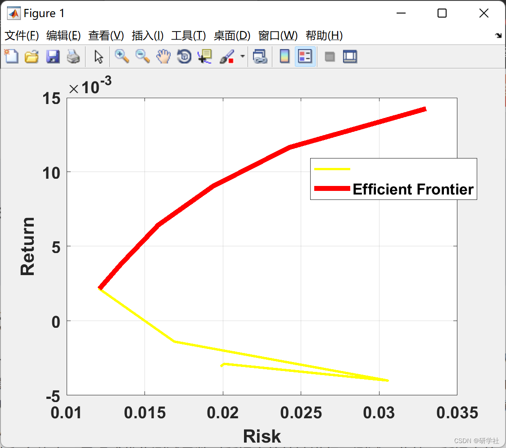
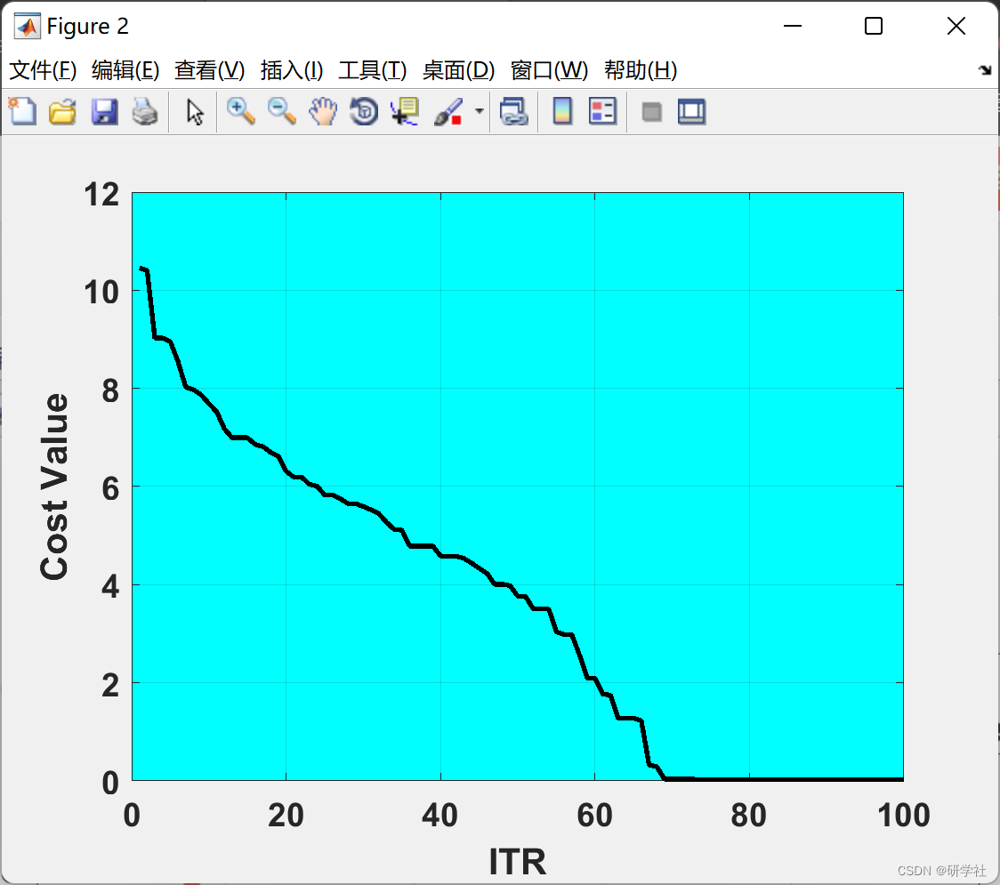
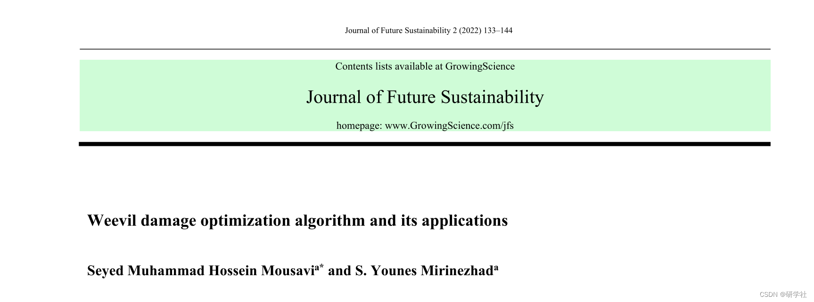

# Portfolio Problem Optimization Algorithm Based on Entomopodia Damage (Matlab Code Implementation)

​  
Editor
Then this paper solves the TSP problem based on the optimizing algorithm of ant damage, and realizes it with Matlab code.
📚2 Running Results Editing
Editor
Part of the code:
data=load('mydata');  
R=data.R;  
nAsset=size(R,2);  
MinRet=min(mean(R,1));  
MaxRet=max(mean(R,1));  
nSol=10;  
DR=linspace(MinRet,MaxRet,nSol);  
model.R=R;  
model.method='cvar';  
model.alpha=0.95;  
W=zeros(nSol,nAsset);  
WReturn=zeros(nSol,1);  
WRisk=zeros(nSol,1);  
for k=1:nSol  
model.DesiredRet=DR(k);  
disp(['Running for Solution #' num2str(k) ':']);  
%-----------------------------------  
out = RunWDOA(model);  
%-----------------------------------  
disp('__________________________');  
disp('');  
W(k,:)=out.BestSol.Out.w;  
WReturn(k)=out.BestSol.Out.ret;  
WRisk(k)=out.BestSol.Out.rsk;  
end  
EF=find(~IsDominated(WRisk,WReturn));  
%% Results  
figure;  
plot(WRisk,WReturn,'y','LineWidth',2);  
hold on;  
plot(WRisk(EF),WReturn(EF),'r','LineWidth',4);  
legend('','Efficient Frontier');  
ax = gca;  
ax.FontSize = 14;  
ax.FontWeight='bold';  
set(gca,'Color','w')  
grid on;  
xlabel('Risk');  
ylabel('Return');  
figure;  
plot(out.BestCost,'k', 'LineWidth', 2);  
xlabel('ITR');  
ylabel('Cost Value');  
ax = gca;  
ax.FontSize = 14;  
ax.FontWeight='bold';  
set(gca,'Color','c')  
grid on;  
out.BestSol.Out  
🎉3 References
🌈4 Matlab code and article reading

## Images

<!-- PAYMENT_BLOCK -->

## Get this dataset

- Payment link (Stripe): [Buy now](https://buy.stripe.com/3cs8yP7sY87d0vu9AB)
- Payment QR code: 

<!-- /PAYMENT_BLOCK -->
